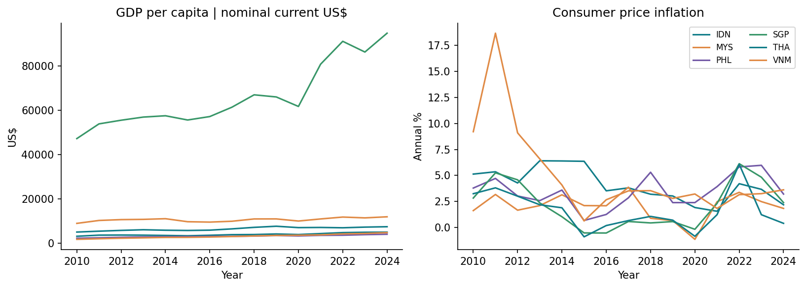

# Automated Analytics Pipeline: Raw Data to PostgreSQL and Dashboard

**Wawan Saputra | Independent Portfolio Project | 2026 | Project 6/8**

## Overview
Project terimplementasi dengan data publik, kode analisis yang dapat dijalankan, notebook, tabel dan grafik hasil eksekusi aktual. Tidak menggunakan hasil numerik sintetis.

## Research / Business Question
Bagaimana membangun pipeline data ekonomi yang tervalidasi, idempotent, dan menghasilkan tabel analitik yang siap dipakai dashboard?

## Dataset
World Bank WDI: 6 negara Asia Tenggara × 3 indikator × 15 tahun 2010–2024 = 270 observasi. Indikator GDP per capita nominal current US$, inflasi annual %, dan populasi.

Sumber: [dokumentasi sumber](https://datahelpdesk.worldbank.org/knowledgebase/articles/898581). URL unduhan, waktu pengambilan UTC, ukuran dan SHA-256 tersedia pada `data/source_manifest.json`. Snapshot sumber disimpan di `data/raw/`, sehingga rerun analisis menggunakan data yang sama. Atribusi dan batas penggunaan tercantum di [THIRD_PARTY_DATA.md](THIRD_PARTY_DATA.md).

## Methods
API JSON snapshot, checksum manifest, domain/key validation, SQLAlchemy normalized relational schema, PostgreSQL foreign keys/composite PK, transactional upserts, repeat-load idempotency, database value roundtrip, conditional SQL pivot dan window LAG, Streamlit dashboard.

## Scope and Assumptions
PostgreSQL adalah backend utama dan telah diuji pada database lokal. SQLite tersedia secara eksplisit untuk penggunaan portable. Refresh dijalankan secara manual melalui --refresh; project tidak memasang jadwal otomatis. Dataset latest-vintage bukan arsip vintage historis.

## Workflow
1. Baca atau unduh snapshot sumber; verifikasi checksum dan validasi data.
2. Bentuk dataset analisis dengan aturan yang terdokumentasi.
3. Jalankan metode statistik/model sesuai desain studi.
4. Simpan hasil, diagnostik, visualisasi dan ringkasan interpretasi.

## Key Results and Interpretation
Lihat [executive summary](outputs/executive_summary.md) untuk hasil aktual, interpretasi, rekomendasi, limitations, dan dua bullet CV. Hasil terstruktur tersedia di [metrics.json](outputs/metrics.json), dengan tabel pendukung di `outputs/tables/`. Angka README tidak digandakan agar tidak tertinggal dari hasil rerun.

## Visualizations


## Reproducibility
Python 3.11 diuji. Jalankan perintah berikut dari folder project. `requirements-lock.txt` mencatat versi paket yang benar-benar digunakan; `requirements.txt` adalah daftar dependensi langsung. Gunakan environment terpisah untuk setiap project.

```powershell
python -m venv .venv
.\.venv\Scripts\python.exe -m pip install -r requirements-lock.txt
Copy-Item .env.example .env
# Edit .env: set a local password and use the same password in DATABASE_URL.
docker compose up -d --wait
.\.venv\Scripts\python.exe -m src.run
.\.venv\Scripts\python.exe -m unittest discover -s tests -v
```

Alternatif portable tanpa server: `python -m src.run --backend sqlite`. PostgreSQL tetap backend utama. Refresh sumber: `python -m src.run --refresh`. `docker compose stop` menghentikan server tanpa menghapus volume. Kredensial lokal `.env` tidak disertakan dalam arsip atau Git.


Dashboard: `python -m streamlit run app.py`. Jalankan dari folder project. 
Untuk membuka notebook: instal `jupyterlab ipykernel`, lalu `python -m jupyterlab`. Notebook EDA, modeling dan reporting membaca snapshot/hasil yang disimpan. Notebook modeling menjelaskan dan menyediakan perintah rerun analisis; tidak melatih ulang secara tersembunyi ketika sekadar melihat hasil. Seluruh notebook telah dieksekusi untuk pemeriksaan.

## Repository Structure
```text
reproducible-data-pipeline/
├── README.md
├── THIRD_PARTY_DATA.md
├── data/                 # raw, processed, source manifest
├── notebooks/            # EDA, modeling, interpretation
├── src/                  # reusable analysis functions and CLI
├── tests/                # meaningful integrity and statistical checks
├── outputs/
│   ├── figures/
│   ├── tables/
│   ├── metrics.json
│   ├── environment.json
│   └── executive_summary.md
├── requirements.txt
└── requirements-lock.txt
```

## Limitations and Future Work
PostgreSQL adalah backend utama dan telah diuji pada database lokal. SQLite tersedia secara eksplisit untuk penggunaan portable. Refresh dijalankan secara manual melalui --refresh; project tidak memasang jadwal otomatis. Dataset latest-vintage bukan arsip vintage historis.

Batasan spesifik dan rencana pengembangan dibahas dalam executive summary. Hasil adalah portfolio riset terapan yang bergantung pada dataset dan asumsi; tidak menggantikan validasi lapangan atau penerapan produksi.

## Author
Wawan Saputra

## Runtime lokal pada komputer ini

Runtime PostgreSQL pengujian tersimpan di folder pendukung `../portfolio-build-tools/`. Mulai dengan `powershell -ExecutionPolicy Bypass -File scripts/start_local_database.ps1`, lalu `python -m src.run`. Hentikan dengan script `scripts/stop_local_database.ps1`. Runtime dan kredensial lokal tidak dibundel dalam ZIP; pada komputer lain gunakan Docker Compose atau SQLite sesuai instruksi di atas.
