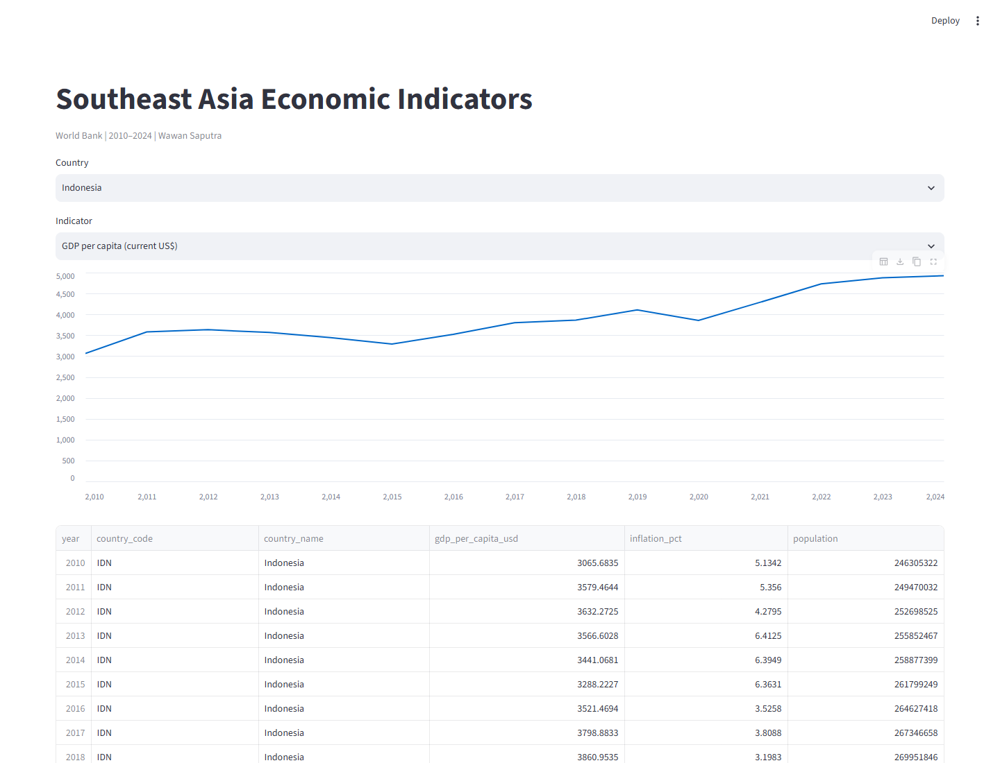
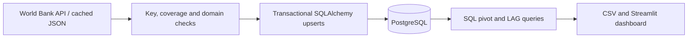

# Reproducible Economic Data Pipeline

**Wawan Saputra · Analytics Engineering & SQL · 2026**

Turn a cached World Bank API snapshot into validated relational data, analytical SQL outputs and an interactive dashboard. PostgreSQL is the primary backend; SQLite supports a portable local demonstration.

[Executive summary](outputs/executive_summary.md) · [SQL queries](sql) · [Notebook walkthroughs](notebooks) · [Data attribution](THIRD_PARTY_DATA.md)

## Verified outcome

| Execution check | Result |
|---|---:|
| Source observations | 270 |
| Coverage | 6 countries × 3 indicators × 15 years |
| PostgreSQL rows after initial/repeated load | 270 / 270 |
| Analytical country-year records | 90 |
| Exact source/database value roundtrip | Passed |
| Tested primary backend | PostgreSQL 17.6 |



## Data and analytical question

Produce consistent 2010–2024 country-year indicators for Indonesia, Malaysia, Thailand, Vietnam, the Philippines and Singapore. Indicators: GDP per capita (**current US$**), consumer-price inflation (**annual %**) and population (**persons**).

Nominal GDP per capita is not adjusted for purchasing power or inflation. Missing observations remain NULL; none occur in the checked-in snapshot. These are historical descriptive indicators, not forecasts or a causal comparison. Source JSON, checksums and indicator-level [CC BY 4.0 attribution](THIRD_PARTY_DATA.md) are retained.

## Architecture



Country and indicator dimension tables link to an observation fact table with a composite primary key. Validation runs before writes; a transaction prevents partial loads. Foreign keys enforce references. Repeated loads update existing keys rather than append duplicates. Integration results include a direct PostgreSQL run; unit tests also exercise rejection, rollback and idempotency in SQLite.

## Quick start without a server

Python 3.11 was tested. From this repository:

```powershell
python -m venv .venv
.\.venv\Scripts\python.exe -m pip install -r requirements-lock.txt
.\.venv\Scripts\python.exe -m src.run --backend sqlite
.\.venv\Scripts\python.exe -m unittest discover -s tests -v
.\.venv\Scripts\python.exe -m streamlit run app.py
```

Linux/macOS: use `.venv/bin/python`. The dashboard can also read the committed analytical CSV without running a database. A SQLite rerun records its own backend in the generated report; the original PostgreSQL verification remains recorded in the publication audit.

## Primary PostgreSQL setup

Requires Docker with Compose, or an existing PostgreSQL server:

```powershell
Copy-Item .env.example .env
# Edit .env: choose a password and use it in both settings.
docker compose up -d --wait
.\.venv\Scripts\python.exe -m src.run
```

The Compose service binds to `127.0.0.1:55432`. For an existing server set `DATABASE_URL` in the environment or ignored `.env`. Keep credentials local. `docker compose stop` preserves the database volume. Machine-specific helper scripts in `scripts/` only work where the sibling local testing runtime exists; portable setup does not depend on it.

## Refresh and outputs

`python -m src.run --refresh` explicitly fetches, validates and replaces the cached snapshot before loading. No recurring scheduler is installed. `sql/country_year.sql` uses conditional aggregation; `sql/year_on_year.sql` uses window `LAG` for GDP/population growth. Outputs include audit metadata, SQL schema, logs, charts and dashboard-ready CSVs. Logs and databases are ignored by Git.

## Limitations and Future Work

Latest-vintage source revisions; fixed selected coverage; no immutable vintage history, migration framework, orchestration or freshness alerting. Direct package versions are pinned, not every transitive dependency. Future work: schema migrations, source-version history, scheduled integration checks and validation of newly added indicators/countries.
